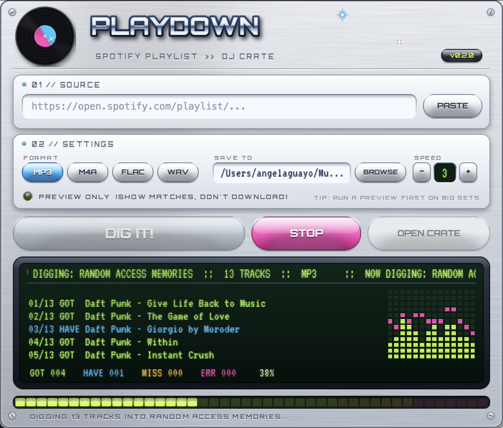

# 🎧 PlayDown

**Paste a Spotify playlist link → get a folder of tagged audio files ready to drop into Rekordbox, Serato, Traktor or VirtualDJ.**



## Why I built this

I was tired of finding songs one by one when I already had the playlists built on Spotify. Every time I prepped a set I'd go through a playlist I'd spent weeks curating, search for each track by hand, download it, rename it, fix the tags… for 40+ songs. The playlist already existed, so the computer should do the digging.

PlayDown reads the playlist, finds each song online, picks the version that best matches the original (same artist, same title, same length; no live versions, covers, sped-up edits or lyric-video rips), and saves it as a clean, tagged file named `Artist - Title.mp3`.

## Features

- 🔗 Works with **playlist and album** links (`open.spotify.com/...`, `spotify:playlist:...`, `intl-xx` links)
- 🎯 **Smart matching**: scores every YouTube result on title, artist, channel and duration, and penalizes live, cover, remix, sped-up, slowed and nightcore versions unless the Spotify title is that version
- 🏷️ **Clean tags**: title, artist and album come from Spotify, not from the YouTube video
- 📼 `mp3` (320k, default), `m4a`, `flac` or `wav`
- 🗂️ Writes an **`.m3u8` playlist** in Spotify order, so you can import the whole crate as a playlist in your DJ software
- ♻️ **Re-runnable**: tracks already in the folder are skipped, so you can run it again after adding songs on Spotify
- 📝 Anything it couldn't find confidently goes to `_not_found.txt`, so you only dig for those manually
- ⚡ Parallel downloads (`-j`)
- 🔑 No Spotify account or API keys needed (optional keys unlock playlists longer than 100 tracks)
- 💿 A **desktop app** in early-2000s style (brushed metal, gel buttons, chrome logo, green LCD, spinning record) plus a CLI

## Download the app (no Python needed)

Grab the latest build from [**Releases**](https://github.com/Afaguayo/playdown/releases/latest):

| Platform | File |
|---|---|
| Windows 10/11 | `PlayDown-windows.exe`: double-click to run, nothing to install |
| macOS (Apple Silicon) | `PlayDown-macos.zip`: unzip, then right-click `PlayDown.app` → **Open** the first time |

Everything it needs (ffmpeg and the JavaScript runtime YouTube requires) is bundled inside. The app isn't code-signed, so Windows SmartScreen will warn you the first time. Click **More info → Run anyway**.

### Using the app

1. Copy a playlist link in Spotify (**Share → Copy link to playlist**) and hit **PASTE**.
2. Pick a format (**MP3** / **M4A** / **FLAC** / **WAV**), where crates go (**BROWSE**), and how many tracks to grab at once (**SPEED**).
3. Optional: light up **PREVIEW ONLY** to see what each track will match to without downloading.
4. Hit **DIG IT!** and watch the LCD. **STOP** finishes the tracks in progress and stops. Running it again picks up where you left off.
5. **OPEN CRATE** opens the folder. Import the `.m3u8` into your DJ software.

The app remembers your settings between runs.

## Install from source (CLI + app)

You need **Python 3.10+** and a JavaScript runtime (**Node.js** or **Deno**). yt-dlp uses the JS runtime to deal with YouTube's player.

```bash
git clone https://github.com/Afaguayo/playdown.git
cd playdown
python3 -m venv .venv && source .venv/bin/activate
pip install -e .

playdown-gui          # the desktop app
playdown --help       # the command-line version
```

You don't need to install `ffmpeg`: if it isn't on your system, PlayDown uses the copy bundled with `imageio-ffmpeg`.

> Stuck on an older Python (macOS ships 3.9)? Install [uv](https://docs.astral.sh/uv/) and run `uv venv --python 3.12 .venv && uv pip install -e .`

## Usage

```bash
# Dig a whole playlist into ./crates/<Playlist Name>/
playdown "https://open.spotify.com/playlist/37i9dQZF1DXcBWIGoYBM5M"

# Preview which video each track will match to without downloading anything
playdown "<playlist link>" --dry-run

# Choose format, output folder and parallelism
playdown "<playlist link>" -f m4a -o ~/Music/DJ -j 5
```

Output:

```
crates/
└── Friday Warmup/
    ├── Daft Punk - One More Time.mp3
    ├── Fred again.. - Delilah (pull me out of this).mp3
    ├── ...
    ├── Friday Warmup.m3u8      ← import this into your DJ software
    └── _not_found.txt          ← only if something couldn't be matched
```

| Flag | Default | What it does |
|---|---|---|
| `-o, --out` | `crates` | Parent folder; each playlist gets its own subfolder |
| `-f, --format` | `mp3` | `mp3`, `m4a`, `flac`, `wav` |
| `-j, --jobs` | `3` | Tracks downloaded at the same time |
| `--dry-run` | off | Show matches only |
| `--verbose` | off | Show yt-dlp output for debugging |

### Playlists longer than 100 tracks

Without keys, PlayDown reads Spotify's public embed page, which only lists the first 100 tracks. For longer playlists, create a free app at the [Spotify developer dashboard](https://developer.spotify.com/dashboard) and export its credentials:

```bash
export SPOTIFY_CLIENT_ID=your_id
export SPOTIFY_CLIENT_SECRET=your_secret
```

Private playlists can't be read either way. Make the playlist public (or copy it to a public one) first.

## How matching works

For each track it searches YouTube for `Artist - Title`, then scores the top 8 results:

| Signal | Effect |
|---|---|
| Title words present | up to +50 |
| Main artist in title/channel | +20 |
| Duration within 3s / 10s of Spotify | +25 / +15 (big penalty past 30s) |
| Official "Artist - Topic" channel / artist's own channel | +20 / +12 |
| "live", "cover", "remix", "sped up", "nightcore", "extended"… not in the Spotify title | −25 each |
| Lyric-video / translation re-upload | −12 |

The highest score wins if it clears the confidence threshold. Otherwise the track goes to `_not_found.txt` instead of saving a wrong song. Run `--dry-run` first on an important set to double-check the matches.

## Heads-up on audio quality

YouTube audio is lossy, roughly 128–160 kbps Opus/AAC. Converting it to 320k MP3 or FLAC makes files that load in every DJ app, but it doesn't add quality that wasn't there. That's fine for practice, planning sets and casual gigs. For big systems or clubs, buy the tracks you actually play (Beatport, Bandcamp, iTunes) or use a record-pool subscription.

## Legal

This tool is for personal use. Only download music you have the right to use, and respect artists' copyrights and YouTube's Terms of Service. Support the artists you play.

## Development

```bash
pip install -e '.[dev]'
pytest
playdown-gui --selftest report.txt   # checks ffmpeg, JS runtime, GUI, Spotify + YouTube
```

### Building the .exe / .app

Pushing a `v*` tag runs [`.github/workflows/build.yml`](.github/workflows/build.yml). It builds `PlayDown.exe` on Windows and `PlayDown.app` on macOS with PyInstaller, bundles Deno, runs the self-test **on the built app**, and attaches both to the GitHub release.

```bash
git tag v0.2.1 && git push origin v0.2.1
```

To build locally (a Windows .exe has to be built on Windows):

```bash
pip install -e '.[dev]'
DENO_BIN=/path/to/deno pyinstaller --noconfirm packaging/PlayDown.spec   # → dist/
```

Project layout:

```
playdown/
├── spotify.py     # link parsing + track list (Web API or embed page)
├── matcher.py     # scoring YouTube candidates against the Spotify track
├── downloader.py  # yt-dlp search/download, ffmpeg + JS runtime discovery, tagging
├── engine.py      # the dig: parallel runs, events, .m3u8 + report (shared by CLI and app)
├── cli.py         # command-line front end
├── gui.py         # the desktop app (Tk canvas, worker thread, self-test)
├── skin.py        # the Y2K look: chrome type, gel buttons, LCD, LEDs, vinyl, all drawn with Pillow
└── assets/        # icon + fonts (Orbitron, VT323, both SIL Open Font License)
packaging/         # PyInstaller spec + entry point
```

Built on [yt-dlp](https://github.com/yt-dlp/yt-dlp), [mutagen](https://github.com/quodlibet/mutagen), [imageio-ffmpeg](https://github.com/imageio/imageio-ffmpeg), [Pillow](https://python-pillow.org) and [Deno](https://deno.com). Fonts: [Orbitron](https://fonts.google.com/specimen/Orbitron) and [VT323](https://fonts.google.com/specimen/VT323) (SIL OFL 1.1).

## License

MIT
